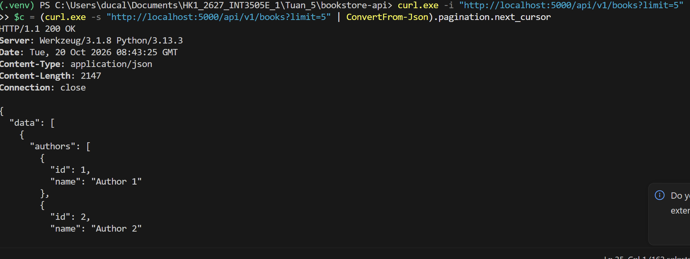
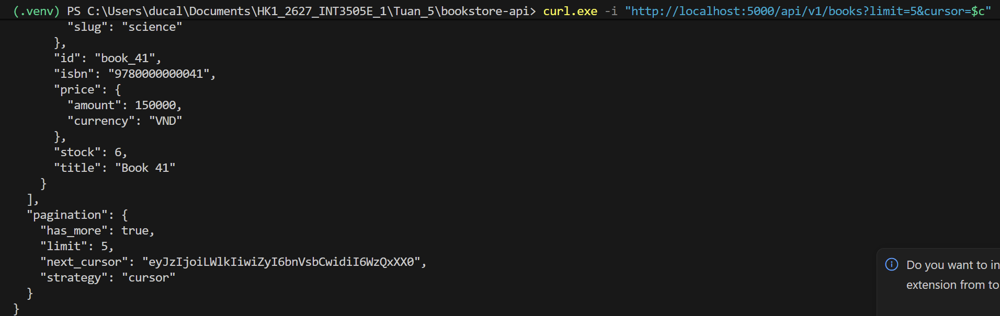
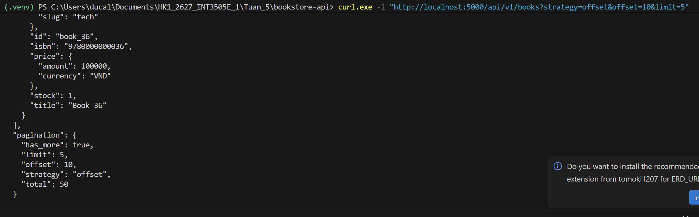
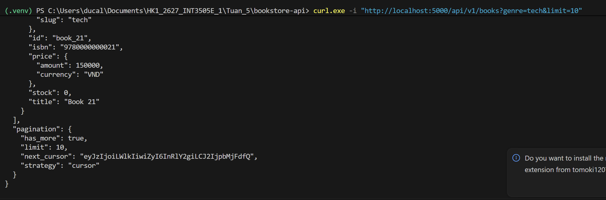
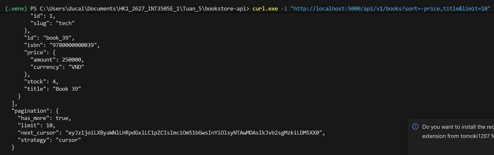
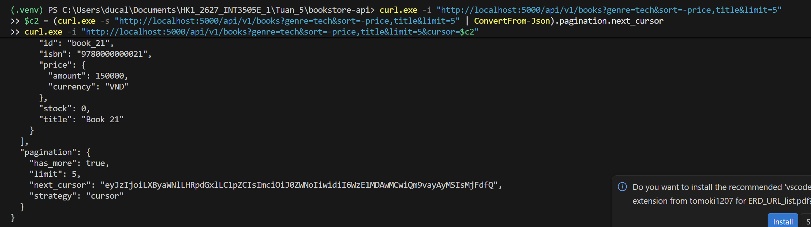
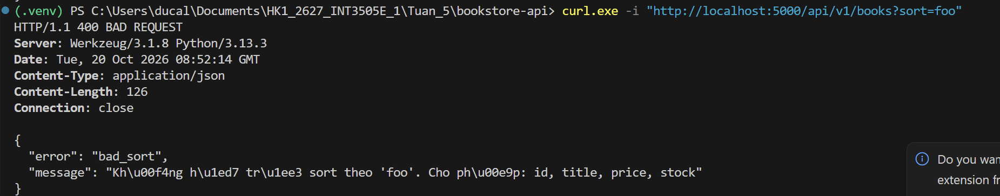
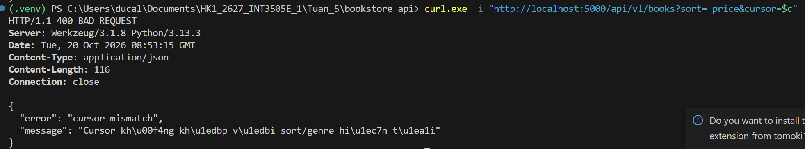
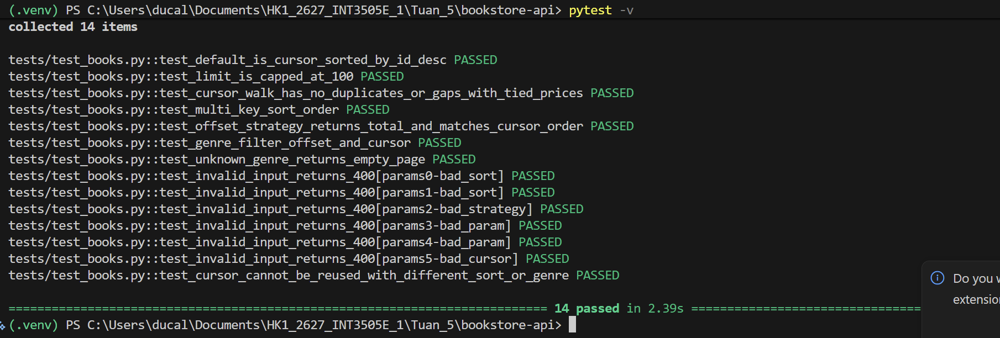
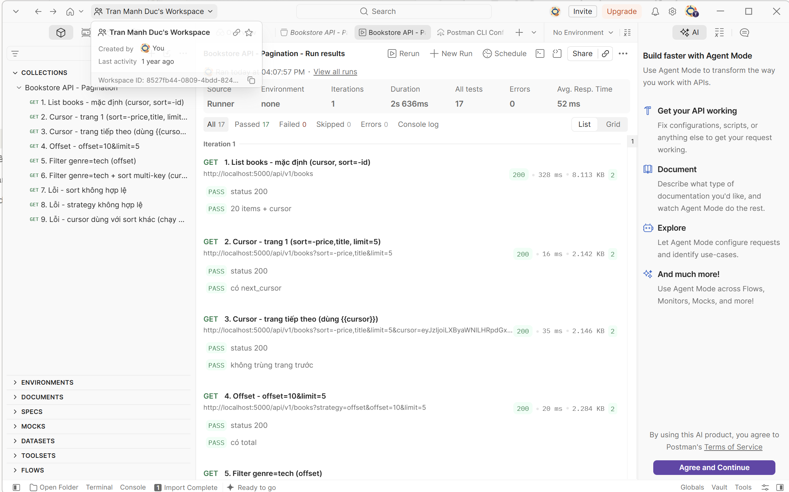

## 1. Danh sách REST API

| Method | Endpoint | Chức năng |
|---|---|---|
| GET | `/api/v1/books` | Lấy danh sách sách (phân trang, lọc, sort) |

Tham số của `GET /api/v1/books`:

| Tham số | Mặc định | Ý nghĩa |
|---|---|---|
| `strategy` | `cursor` | `cursor` hoặc `offset` |
| `limit` | 20 | Số item mỗi trang, tối đa 100 |
| `offset` | 0 | Chỉ dùng khi `strategy=offset` |
| `cursor` | (không) | Chỉ dùng khi `strategy=cursor`, lấy từ `pagination.next_cursor` |
| `genre` | (không) | Slug thể loại: `tech`, `novel`, `science` |
| `sort` | `-id` | `id`, `title`, `price`, `stock`; nhiều khóa cách nhau bằng dấu phẩy, `-` là giảm dần |

Lỗi trả về `400` dạng `{"error": "<code>", "message": "..."}` với code: `bad_sort`, `bad_strategy`, `bad_param`, `bad_cursor`, `cursor_mismatch`.

## 2. Kiểm thử API

### Test 1 – Cursor pagination (mặc định) – trang 1

```
curl.exe -i "http://localhost:5000/api/v1/books?limit=5"
$c = (curl.exe -s "http://localhost:5000/api/v1/books?limit=5" | ConvertFrom-Json).pagination.next_cursor
```

Dòng thứ hai lưu `next_cursor` vào biến `$c` để dùng ở các test sau.



### Test 2 – Cursor pagination – trang tiếp theo

```
curl.exe -i "http://localhost:5000/api/v1/books?limit=5&cursor=$c"
```



### Test 3 – Offset pagination (có total)

```
curl.exe -i "http://localhost:5000/api/v1/books?strategy=offset&offset=10&limit=5"
```



### Test 4 – Filter theo genre

```
curl.exe -i "http://localhost:5000/api/v1/books?genre=tech&limit=10"
```



### Test 5 – Sort nhiều khóa

Giá giảm dần, cùng giá thì tên tăng dần.

```
curl.exe -i "http://localhost:5000/api/v1/books?sort=-price,title&limit=10"
```



### Test 6 – Kết hợp genre + sort + cursor

```
curl.exe -i "http://localhost:5000/api/v1/books?genre=tech&sort=-price,title&limit=5"
$c2 = (curl.exe -s "http://localhost:5000/api/v1/books?genre=tech&sort=-price,title&limit=5" | ConvertFrom-Json).pagination.next_cursor
curl.exe -i "http://localhost:5000/api/v1/books?genre=tech&sort=-price,title&limit=5&cursor=$c2"
```



### Test 7 – Xử lý lỗi

**Sort không hợp lệ**

```
curl.exe -i "http://localhost:5000/api/v1/books?sort=foo"
```



**Dùng cursor với sort khác** (cursor `$c` của Test 1 được tạo với sort mặc định `-id`)

```
curl.exe -i "http://localhost:5000/api/v1/books?sort=-price&cursor=$c"
```



### Test 8 – Unit test

```
pytest -v
```



### Test 9 – Postman collection



## 3. Thiết kế chính

- **Sort whitelist**: chỉ cho sort theo `id`, `title`, `price`, `stock`, không đưa tên cột thô vào `order_by()` (chống SQL injection).
- **Tie-break bằng id**: luôn thêm `id` vào cuối danh sách sort nên thứ tự luôn xác định dù trùng giá.
- **Cursor đa khóa (keyset)**: cursor lưu giá trị các khóa sort của item cuối trang. Trang sau dùng điều kiện `(k1 > v1) OR (k1 = v1 AND k2 > v2) OR ...` (đổi `>` thành `<` với khóa giảm dần).
- **Cursor ràng buộc với sort và genre**: dùng cursor với sort hoặc genre khác sẽ trả `400 cursor_mismatch`.
- **+1 trick**: lấy `limit + 1` dòng để biết còn trang sau mà không cần `COUNT`.
- **Tránh N+1**: dùng `selectinload` khi trả kèm `category` và `authors`.