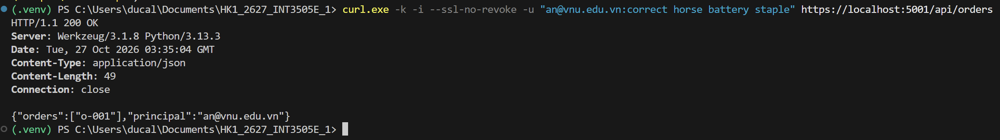
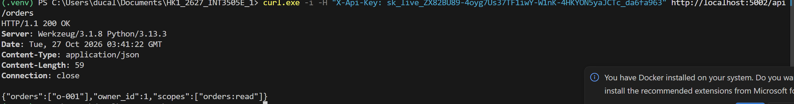
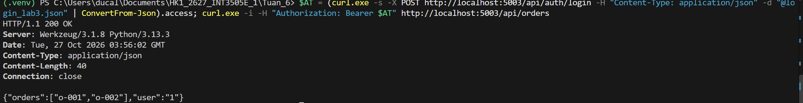
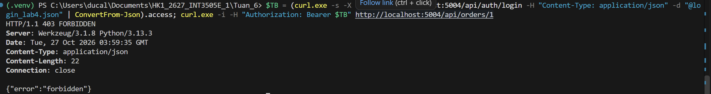
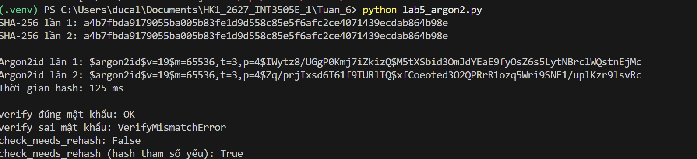

# SOA — Buổi 6: Authentication & Authorization

## Lab 1 — Basic Auth

curl.exe -k -i --ssl-no-revoke -u "an@vnu.edu.vn:correct horse battery staple" https://localhost:5001/api/orders

Kết quả mong đợi: `HTTP/1.1 200 OK`, body có `"principal":"an@vnu.edu.vn"`.

## Lab 2 — API Key

curl.exe -i -H "X-Api-Key: <API_KEY>" http://localhost:5002/api/orders

Kết quả mong đợi: `HTTP/1.1 200 OK`, body có `"scopes":["orders:read"]`.

## Lab 3 — JWT

$AT = (curl.exe -s -X POST http://localhost:5003/api/auth/login -H "Content-Type: application/json" -d "{\"email\":\"an@vnu.edu.vn\",\"password\":\"correct horse battery staple\"}" | ConvertFrom-Json).access; curl.exe -i -H "Authorization: Bearer $AT" http://localhost:5003/api/orders

Kết quả mong đợi: `HTTP/1.1 200 OK`, body có `"orders":["o-001","o-002"]`.

## Lab 4 — RBAC + Scope + Ownership

$TB = (curl.exe -s -X POST http://localhost:5004/api/auth/login -H "Content-Type: application/json" -d "{\"email\":\"binh@vnu.edu.vn\",\"password\":\"password123\"}" | ConvertFrom-Json).access; curl.exe -i -H "Authorization: Bearer $TB" http://localhost:5004/api/orders/1

Kết quả mong đợi: `HTTP/1.1 403 FORBIDDEN`, body `{"error":"forbidden"}`. Đơn hàng 1 thuộc `an`, `binh` không phải chủ sở hữu và không phải admin nên bị chặn (chống BOLA).

## Lab 5 — Hash mật khẩu

python lab5_argon2.py

Kết quả mong đợi:

- SHA-256 chạy hai lần cho cùng một chuỗi hash.
- Argon2id chạy hai lần cho hai chuỗi hash khác nhau (do salt ngẫu nhiên).
- `verify` đúng mật khẩu in `OK`, sai mật khẩu in `VerifyMismatchError`.
- `check_needs_rehash` là `False` với tham số hiện tại và `True` với hash tham số yếu.

