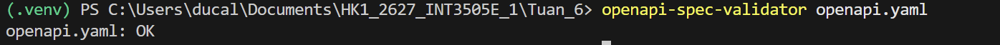
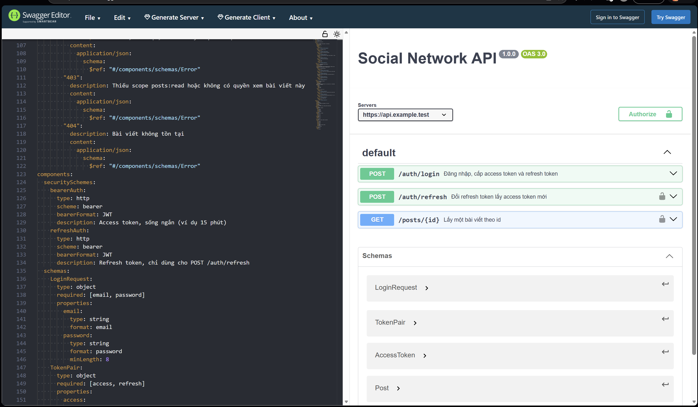

## Bài tập về nhà

### Phần 1 — OpenAPI spec (`openapi.yaml`)

Spec dùng OpenAPI 3.0.3, định nghĩa hai security scheme kiểu `http bearer` (JWT):

- `bearerAuth`: access token, sống ngắn (15 phút), dùng cho API nghiệp vụ.
- `refreshAuth`: refresh token, chỉ dùng cho `POST /auth/refresh`.

Trả lời ba câu hỏi của đề:

| Endpoint | Xác thực | Scope cần có | Status code có thể trả |
|----------|----------|--------------|------------------------|
| `POST /auth/login` | Không (public) | Không | `200` đăng nhập thành công; `400` body thiếu field hoặc sai định dạng; `401` sai email hoặc mật khẩu; `429` vượt giới hạn số lần đăng nhập |
| `POST /auth/refresh` | `refreshAuth` (refresh token) | Không | `200` cấp access token mới; `401` token thiếu, hết hạn, sai chữ ký hoặc đã bị thu hồi; `422` dùng nhầm access token ở endpoint chỉ nhận refresh token; `429` vượt giới hạn số lần refresh |
| `GET /posts/{id}` | `bearerAuth` (access token) | `posts:read` | `200` trả bài viết; `401` token không hợp lệ; `403` thiếu scope `posts:read` hoặc không có quyền xem bài này; `404` bài viết không tồn tại |

Kiểm tra spec hợp lệ (trong PowerShell đã kích hoạt venv):

(images/btvn1.png)

(images/btvn2.png)

(images/btvn3.png)

### Phần 2 — Rà soát bảo mật (`SecurityAudit.md`)
Điểm có thể lộ:

| # | Điểm có thể lộ | Endpoint | Mức | Biện pháp | OWASP API 2023 |
|---|----------------|----------|-----|-----------|----------------|
| 1 | Đọc bài viết riêng tư của người khác bằng cách đoán `id` | `GET /posts/{id}` | Cao | Kiểm quyền đối tượng (chủ bài, bạn bè, chia sẻ) ở mọi request; trả 403/404 thống nhất; dùng id khó đoán | API1 BOLA |
| 2 | Dò tài khoản tồn tại qua thông báo lỗi hoặc thời gian phản hồi | `POST /auth/login` | Trung bình | Thông báo lỗi chung `invalid_credentials`; luôn chạy hash kể cả khi email không tồn tại | API2 Broken Authentication |
| 3 | Brute force và credential stuffing do thiếu giới hạn số lần thử | `POST /auth/login` | Cao | Rate-limit theo IP và theo tài khoản, trả 429 kèm `Retry-After`; tránh khóa vĩnh viễn gây từ chối dịch vụ | API2, API4 |
| 4 | Refresh token bị đánh cắp dùng được tới 30 ngày | `POST /auth/refresh` | Cao | Rotate refresh token mỗi lần dùng; lưu `jti` để thu hồi; phát hiện dùng lại token cũ thì hủy cả phiên | API2 |
| 5 | Access token lưu ở localStorage bị lấy qua XSS | Client web | Cao | Dùng BFF và cookie `HttpOnly; Secure; SameSite`; CSP; vẫn chống CSRF | API2 |
| 6 | Response bài viết lộ field thừa (email tác giả, `password_hash`, cờ nội bộ) | `GET /posts/{id}` | Trung bình | Serialize qua DTO, whitelist field trả về, không trả nguyên row DB | API3 Broken Object Property Level Authorization |
| 7 | JWT cấu hình sai: chấp nhận `alg=none`, nhầm HS/RS, không kiểm `exp`, `iss`, `aud` | Mọi endpoint có token | Nghiêm trọng | Allowlist thuật toán, secret ngẫu nhiên ≥256 bit lấy từ secret manager, kiểm `exp`/`iss`/`aud`, hỗ trợ `kid` để xoay khóa | API2 |
| 8 | Log ghi token, mật khẩu hoặc body đăng nhập | Toàn hệ thống | Trung bình | Che field nhạy cảm trong log; không log header `Authorization` | API8 Security Misconfiguration |